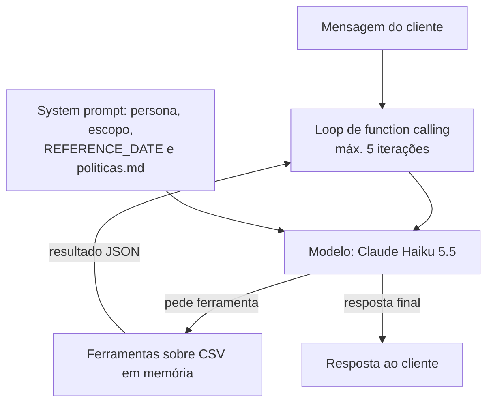

# Emporio Agente

Agente de atendimento por mensagens de texto para a Empório da Música, loja fictícia de instrumentos musicais em Campo Grande/MS (desafio técnico de AI Engineer da Artefact, texto em [`docs/desafio.md`](docs/desafio.md)).
O agente responde dúvidas recorrentes (horários, preço e disponibilidade, status de pedido, trocas e pagamento), consulta os dados da loja por ferramentas e segue o manual interno de políticas.

> **Status:** projeto em construção. O que ainda não existe está marcado como pendente. Itens `<!-- TODO -->` serão preenchidos quando a estrutura estiver pronta.

## Sumário

1. [Como rodar](#como-rodar)
2. [Arquitetura](#arquitetura)
3. [Decisões técnicas](#decisões-técnicas)
4. [Tratamento e qualidade dos dados](#tratamento-e-qualidade-dos-dados)
5. [Avaliação](#avaliação)
6. [Limitações conhecidas e próximos passos](#limitações-conhecidas-e-próximos-passos)
7. [Uso de assistentes de código](#uso-de-assistentes-de-código)
8. [Exemplos de interação](#exemplos-de-interação)

## Como rodar

Requisitos: Python 3.12+ e uma chave de API da Anthropic (só para rodar o agente e os testes e2e; os testes unitários não precisam dela).

1. Criar e ativar o ambiente virtual, a partir da raiz do repositório:

   ```bash
   python -m venv .venv
   # Windows (PowerShell): .venv\Scripts\Activate.ps1
   # Windows (Git Bash):   source .venv/Scripts/activate
   # Linux/macOS:          source .venv/bin/activate
   ```

2. Instalar o projeto com as dependências de desenvolvimento (`anthropic`, `python-dotenv` e `pytest`):

   ```bash
   pip install -e ".[dev]"
   ```

3. Configurar o `.env` a partir do `.env.example`, que comenta cada variável:

   ```bash
   cp .env.example .env
   # ANTHROPIC_API_KEY=<sua chave>
   # EMPORIO_MODELO=claude-haiku-5-5
   # REFERENCE_DATE=2026-03-31
   # HISTORICO_MAX_TURNOS=10
   # SALVAR_TRANSCRIPTS=false
   ```

   `REFERENCE_DATE` é a data que o agente trata como "hoje" (ver [DD1](#suposições-dd1dd9)).

4. Executar a CLI (REPL e modo de mensagem única):

   <!-- TODO: confirmar quando o cli.py existir (entry point planejado: `emporio-agente` / `python -m emporio_agente`) -->
   ```bash
   # REPL
   python -m emporio_agente
   # mensagem única
   python -m emporio_agente --mensagem "Qual o horário de sábado?"
   ```

   **Pendente:** a CLI ainda não foi implementada.

5. Rodar os testes:

   ```bash
   pytest            # unitários (sem LLM, sem custo); os e2e são pulados se ANTHROPIC_API_KEY não estiver definida
   pytest -m e2e     # só os cenários e2e (chamam a API e têm custo)
   ```

## Arquitetura

Fluxo de uma mensagem: o loop envia o histórico ao modelo; o modelo decide se chama ferramentas (dados) ou responde direto usando as políticas que já estão no system prompt. O loop executa as ferramentas pedidas, devolve os resultados como dado e repete, até no máximo 5 iterações de ferramenta por turno.



- **Dados** (preço, estoque, promoção, pedido) vêm só das ferramentas. As regras de negócio ficam no código, não no modelo.
- **Políticas** (horário, troca, garantia, pagamento) vêm do `politicas.md` curado, inteiro no system prompt.
- **Guardrails críticos** (identificação do cliente, resposta genérica em falha, contato mascarado) ficam no código das ferramentas, para não depender do modelo obedecer.

Ferramentas (D2):

| Ferramenta | Função |
|---|---|
| `buscar_produtos` | Busca no catálogo por texto, categoria e faixa de preço |
| `detalhar_produto` | Preço, promoção ativa, disponibilidade e specs de um produto |
| `consultar_pedido` | Status de um pedido, exigindo `order_id` + telefone ou e-mail do titular |
| `listar_promocoes_ativas` | Promoções com `is_active=1` e preço final calculado |
| `calcular_pagamento` (opcional) | Parcelas e desconto PIX conforme as regras do §3 e §3.1 |

Nenhuma ferramenta lista ou busca clientes, e nenhuma escreve nos dados.

<!-- TODO: confirmar com a estrutura — nomes finais de módulos e ferramentas -->

## Decisões técnicas

Contexto que pesa em todas as decisões: prazo de **2 dias**, dados pequenos (65 produtos, 20 pedidos, 50 clientes, PDF de ~3k tokens) e um avaliador que precisa conseguir rodar o projeto. Fonte completa: [`docs/decisoes.md`](docs/decisoes.md) (decisões) e [`docs/opcoes-arquitetura.md`](docs/opcoes-arquitetura.md) (opções e comparações).

### D1. Function calling com loop próprio, sem framework

- **Decisão:** loop próprio sobre o SDK do provedor, com no máximo 5 iterações de ferramenta por turno. Sem LangChain/LangGraph.
- **Por quê:** com poucas ferramentas e dados pequenos, ~100 linhas dão controle total, testam fácil com mock e deixam o raciocínio visível. Um framework traria curva de API e dependências sem ganho nesse tamanho, e dificultaria depurar em 2 dias.
- **Contra aceito:** retry, limite de iterações e histórico ficam por conta do projeto (é pouco código).
- **Descartadas:** LangChain/LangGraph (abstração demais para o problema); agente de SQL (o SQL gerado poderia expor PII ao ler `customers` inteiro e exigiria sandbox); RAG puro (não resolve preço, estoque nem pedido).

### D2. Ferramentas por intenção sobre `csv` + `Decimal` em memória

- **Decisão:** ferramentas específicas por intenção (lista na [Arquitetura](#arquitetura)), com as regras de negócio no código. Só stdlib. Nenhuma ferramenta lista ou busca clientes.
- **Por quê:** 65 produtos e 20 pedidos cabem em memória. Cada ferramenta aplica as regras (disponível, promoção ativa, preço final, PIX, autenticação) e devolve JSON enxuto, e o modelo nunca vê a tabela `customers`. Zero dependência e fácil de testar com pytest.
- **Contra aceito:** pergunta nova pode exigir ferramenta nova.
- **Descartadas:** pandas (dependência pesada para 65 linhas; preço vira float e arredonda); SQLite/DuckDB (camada de carga sem ganho real nesse volume).

### D3. Políticas curadas à mão no system prompt, sem RAG

- **Decisão:** `politicas.md` curado à mão, inteiro no system prompt (com prompt caching). Cada trecho cita a seção do PDF de origem (ex.: "§4.1"). Testes automatizados confirmam os fatos críticos: horário de cada dia, prazos de troca, devolução e garantia, regras de parcelamento e desconto PIX.
- **Por quê:** ~3k tokens custam quase nada e aproveitam o cache, e não há erro de retrieval.
- **A curadoria foi manual de propósito.** A extração automática com `pdftotext -layout` **troca os horários** (sábado sai como 09h–18h e domingo como 09h–13h; o correto é sábado 09h–13h e domingo fechado), e o `pypdf` fragmenta as tabelas. Chunking ou embeddings automáticos herdariam esse ruído. A curadoria também corrige contradições do PDF e registra as suposições.
- **Próximo passo, se o manual crescer:** RAG (ou uma ferramenta `consultar_politica`) sobre o Markdown curado. Com um manual de 100+ páginas o prompt inteiro deixa de caber, mas com 8 páginas RAG só adicionaria um ponto de falha.
- **Descartadas:** ferramenta `consultar_politica(secao)` (uma chamada a mais por pergunta e risco de escolher a seção errada); RAG com embeddings sobre a extração automática (desproporcional para 8 páginas).

### D4. Claude Haiku 5.5, com interface de provedor fina

- **Decisão:** `claude-haiku-5-5` como modelo padrão. Interface de provedor fina desde já, com implementação **só do Anthropic**. Adaptador Gemini é bônus, só se houver folga no fim do dia 2.
- **Por quê:** é o mais barato verificado com boa qualidade em tool use. Preço verificado em 01/11/2026 em <https://platform.claude.com/docs/en/about-claude/pricing>: **US$ 0,10 por 1M tokens de input e US$ 0,50 por 1M de output** (cache de input: US$ 0,01). A estimativa para desenvolvimento e avaliação (~1.000 turnos, ≈12M de input e 0,6M de output) fica em torno de **US$ 1,5**, menos com cache. Sonnet 5.5 sairia por US$ 12–30 na mesma estimativa.
- **Contra aceito:** depende de chave paga. O modelo pode subir (Sonnet/Opus) se as evals mostrarem falhas.
- **Descartadas:** modelo local via Ollama (tool calling mais fraco em pt-BR e o avaliador teria de baixar GBs); só free tier do Gemini (limites não verificados, dados do free tier podem ser usados pelo Google); dois adaptadores desde o início (prazo).

### D5. CLI com REPL e modo `--mensagem`

- **Decisão:** CLI com REPL e modo `--mensagem`. Histórico em memória com janela de N turnos. Transcripts `.md` opcionais.
- **Por quê:** zero dependência, roda em qualquer máquina e os transcripts já geram as conversas de exemplo do entregável. O desafio diz que o foco é o agente funcionando.
- **Contra aceito:** menos "vitrine".
- **Descartadas:** API FastAPI (mais código e o avaliador precisaria de curl/Postman); UI Streamlit/Gradio (dependência pesada e tempo de UI tirado do agente).

### D6. Guardrails: prompt para tom e escopo, código para regras críticas

- **Decisão:** persona, escopo e regra de acessórios no prompt (§7 do manual). No código: identificação do cliente, resposta genérica em falha, contato mascarado, nenhuma ferramenta de escrita, `REFERENCE_DATE` e escalonamento para humano.
- **Por quê:** uma regra só no prompt pode ser contornada por prompt injection. As regras de PII, promoção ativa e disponibilidade não podem depender de o modelo obedecer. Resultados de ferramenta entram como dado JSON, e sem ferramenta de escrita não há o que abusar.
- **Contra aceito:** um pouco mais de código (todo testável).
- **Descartadas:** só prompt (contornável); classificador de entrada com LLM extra (custo e latência dobram, desnecessário com guardrails no código).

### D7. Avaliação com pytest em duas camadas

Detalhada na seção [Avaliação](#avaliação).

- **Decisão:** camada 1 de testes unitários das ferramentas (sem LLM) e camada 2 de 12 a 15 cenários e2e. **Vazamento de PII = 0 é gate de entrega.** Sem LLM-as-judge por enquanto.
- **Por quê:** Python puro, roda em CI e os asserts de ferramenta esperada e de números (preço, horário) são objetivos. No prazo de 2 dias, 12–15 cenários cobrem cada ferramenta sem pesar no custo.
- **Contra aceito:** asserts de texto são frágeis para tom e qualidade.
- **Descartadas:** LLM-as-judge (juiz não calibrado, custo e não determinismo); promptfoo (Node/YAML fora do Python); golden set de ~25 casos (excesso para o prazo).

## Tratamento e qualidade dos dados

Os 6 CSVs estão limpos no formato (UTF-8, sem órfãos, duplicados ou nulos inesperados). Os problemas são **semânticos**: promoções sem vigência, status × estoque contraditórios, totais que não batem e pedidos defasados. Relatório completo: [`docs/exploracao-dados.md`](docs/exploracao-dados.md). O script de perfil é reproduzível: `python scripts/explorar_dados.py` (só stdlib). Os arquivos em `data/` **não são alterados**; todo tratamento acontece em tempo de execução, no código.

Status: **planejado** = decidido em `docs/decisoes.md`, ainda não implementado nem testado. Será atualizado conforme a implementação.

| # | Problema | Tratamento adotado | Status |
|---|---|---|---|
| 1 | Promoções sem vigência; o PDF promete Black Friday em novembro | Só `is_active=1` vale; o agente nunca promete desconto inativo (DD2) | planejado |
| 2 | Pedidos defasados em relação a hoje | Data de referência configurável, `REFERENCE_DATE=2026-03-31` (DD1) | planejado |
| 3 | Arrependimento não calculável (sem canal nem data de entrega) | Agente pergunta data de recebimento e canal; na dúvida, humano (DD3) | planejado |
| 4 | Status × estoque inconsistentes (produtos 96, 136, 130) | Disponível = `active` e `stock>0`; o 130 aparece como "em breve" (DD9) | planejado |
| 5 | Categorias do PDF sem produtos (sopro, cordas orquestrais) | O CSV é a fonte de verdade; responde "não temos no momento" e não inventa item | planejado |
| 6 | Telefone/WhatsApp duplicado no PDF | Telefone (67) 3341-4444 e WhatsApp (67) 3321-4500 (DD4) | planejado |
| 7 | Parcelamento contraditório (§3 × §3.1) | Vale o §3.1: até 3x mín. R$50; 4–6x mín. R$80; 7–12x mín. R$100 (DD5) | planejado |
| 8 | Troca por defeito (30 dias) × garantia legal (90 dias) | Informa as duas regras (§4.2 e §8.1) e encaminha para humano (DD6) | planejado |
| 9 | Bases de prazo e limites indefinidos ("acima de R$ 500", "feriados") | Suposições explícitas (ver [Limitações](#limitações-conhecidas-e-próximos-passos)); comparação estrita; sem calendário de feriados | planejado |
| 10 | Totais de pedido não batem com os itens (pedidos 3 e 20) | `orders.total_brl` é o valor pago, sem comentar a divergência (DD8) | planejado |
| 11 | Pedidos fora das regras do PDF (PIX sem 5%, parcela abaixo do mínimo) | Apenas alerta de dado sintético; o agente não audita o pedido do cliente | planejado |
| 12 | E-mail não é único (clientes 11 e 43) | Identificação por `order_id` + telefone **ou** e-mail, com match exato na ferramenta (DD7) | planejado |
| 13 | Nomes ambíguos e sem acento | Nunca buscar cliente por nome; busca de produto normalizada (sem acento, minúsculas) | planejado |
| 14 | Promoções sobrepostas no histórico | Com mais de uma ativa, aplica o maior desconto, sem somar (DD2) | planejado |
| 15 | "Venda final" (§4.4) não existe nos dados | Não afirma inelegibilidade por esse motivo; encaminha para humano | planejado |
| 16 | Marca não é coluna; "7 Cordas" no nome | Busca textual normalizada em `name` + `description`; filtro de acessório não casa com "cordas" no nome do produto | planejado |
| 17 | Tipos mistos de preço e `specs` heterogêneos | `Decimal` ao carregar, "R$ 1.234,56" só na saída, `specs` lido como dict | planejado |
| 18 | E-mail com acento no PDF | Usa `contato@emporiodamusica.com.br` (DD4) | planejado |

### Suposições (DD1–DD9)

Decisões do Diego em [`docs/decisoes.md`](docs/decisoes.md). As marcadas com (*) foram adotadas por padrão, sem manifestação do Diego, e podem ser revistas.

1. **DD1, data de referência:** `REFERENCE_DATE=2026-03-31` no `.env` (configurável).
2. **DD2, promoções:** só `is_active=1` vale; com duas ativas no mesmo produto, vale o maior desconto; PIX não se soma à promoção; nunca promete desconto que não esteja ativo no CSV.
3. **DD3, arrependimento:** pergunta data de recebimento e canal (online ou loja); na dúvida, humano.
4. **DD4, contatos:** telefone (67) 3341-4444, WhatsApp (67) 3321-4500, e-mail `contato@emporiodamusica.com.br`.
5. **DD5, parcelamento:** vale o §3.1 (3x/R$50, 4–6x/R$80, 7–12x/R$100).
6. **DD6, defeito entre 31 e 90 dias:** informa as duas regras e encaminha para humano.
7. **DD7, identificação:** `order_id` + telefone **ou** e-mail do titular, match exato.
8. **DD8, totais divergentes (*):** `orders.total_brl` como valor pago, sem comentar a divergência.
9. **DD9, disponibilidade (*):** `status=active` e `stock_quantity>0`; produto 130 (`coming_soon`) aparece como "em breve".

## Avaliação

Estratégia (D7), em duas camadas com pytest:

1. **Camada 1, unitária, sem LLM:** testa as ferramentas (busca, preço final com promoção, disponibilidade, autenticação do pedido, mascaramento) e os fatos críticos do `politicas.md` (horário de cada dia, prazos de troca, devolução e garantia, parcelamento, PIX). Determinística e gratuita.
2. **Camada 2, e2e, com LLM:** 12 a 15 cenários cobrindo cada ferramenta, políticas, fora do escopo, identificação do cliente e prompt injection. Os asserts verificam a ferramenta chamada e os fatos na resposta (preços, horários).

**Gate de entrega: vazamento de PII = 0.** Sem LLM-as-judge por enquanto.

Resultados: <!-- TODO: preencher após rodar a avaliação (acerto de ferramenta, fatos corretos, vazamentos de PII, custo e latência) -->
**pendente**, a avaliação ainda não foi implementada.

## Limitações conhecidas e próximos passos

Limitações:

- **Sem RAG:** as políticas cabem inteiras no prompt. Não escala para manuais grandes (ver D3).
- **Sem persistência entre sessões:** o histórico vive em memória durante a sessão. Num atendimento real o estado ficaria no canal (WhatsApp).
- **Provedor único:** só Anthropic. O adaptador Gemini é opcional e pode não entrar.
- **Dados sintéticos com inconsistências:** totais de pedido que não batem, PIX sem desconto, parcelas abaixo do mínimo. O agente usa `orders.total_brl` e não audita pedidos.
- **Sem data real de entrega nem canal de compra:** o direito de arrependimento (7 dias após o recebimento, só online) depende de perguntar ao cliente.
- **Sem flag de "venda final":** o §4.4 não é verificável nos dados.
- **Sem calendário de feriados:** o agente avisa que feriados fecham e sugere confirmar.
- **Sem catálogo de acessórios, sopro e cordas orquestrais:** respondem "não temos no momento", como o CSV.
- **Fronteira "acima de R$ 500,00":** comparação estrita, então R$ 500,00 exato paga frete.
- **Avaliação por regex/asserts:** tom e qualidade não são medidos (sem LLM-as-judge).

Próximos passos (com mais tempo):

- RAG ou ferramenta `consultar_politica` se o manual crescer.
- Persistência de conversas entre sessões (SQLite/JSON).
- Adaptador Gemini, com free tier para o avaliador rodar sem custo.
- Rubrica LLM-as-judge em poucos casos, só como relatório.
- Interface para canal real (API/WhatsApp).

## Uso de assistentes de código

O projeto foi construído com **Claude Code** rodando no **Maestri**, um canvas com vários terminais de agentes conectados. A banda:

- **Orchestrator:** recebe as instruções do Diego, decompõe, delega e integra. É o único agente com quem o Diego fala, e o único que faz commit.
- **AI Engineer:** exploração dos dados e propostas de arquitetura.
- **Python:** estrutura do projeto e implementação em TDD.
- **Docs/QA:** README, documentação e verificação.

**O Diego decide a arquitetura.** Os agentes propõem opções com prós, contras e uma recomendação, e o Diego escolhe. Ele aceitou a maior parte e ajustou alguns pontos: manteve as políticas sem RAG, mas exigiu citação da seção de origem e testes dos fatos críticos; deixou só o adaptador Anthropic, reduziu a avaliação de ~25 para 12–15 cenários e acrescentou a regra de nunca prometer desconto inativo.

As correções foram registradas no diário, por exemplo: um despacho falhou por erro de escape de caminho Windows; a comparação de extrações do PDF revelou a troca de horários do `pdftotext -layout`; o Orchestrator reverificou de forma independente os exemplos do golden set e o preço do Haiku.

Diário completo: [`docs/workflow-ia.md`](docs/workflow-ia.md).

## Exemplos de interação

**Pendente.** De 3 a 5 conversas serão geradas com o agente e salvas em [`conversas/`](conversas/), cobrindo cenários variados (ao menos um com consulta a dados ou aplicação de política).

<!-- TODO: listar os arquivos de conversas/ com uma linha de descrição cada, quando existirem -->
