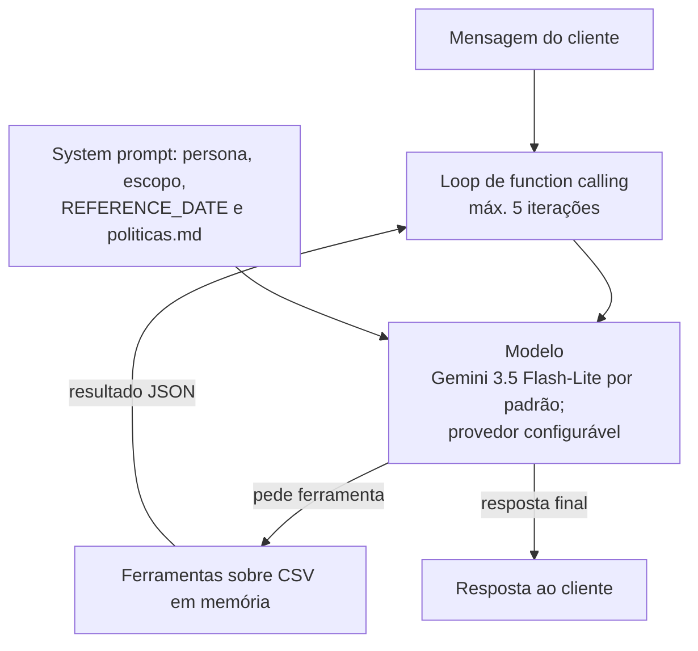

# Emporio Agente

Agente de atendimento por mensagens de texto para a Empório da Música, loja fictícia de instrumentos musicais em Campo Grande/MS (desafio técnico de AI Engineer da Artefact, texto em [`docs/desafio.md`](docs/desafio.md)).
O agente responde dúvidas recorrentes (horários, preço e disponibilidade, status de pedido, trocas e pagamento), consulta os dados da loja por ferramentas e segue o manual interno de políticas.

> **Status:** entrega final. Agente funcional com Gemini no free tier (padrão `gemini-3.5-flash-lite`), 382 testes unitários e 15 cenários e2e com o modelo real. Limitações e itens não validados estão listados em [Limitações](#limitações-conhecidas-e-próximos-passos).

## Sumário

1. [Como rodar](#como-rodar)
2. [Arquitetura](#arquitetura)
3. [Decisões técnicas](#decisões-técnicas)
4. [Tratamento e qualidade dos dados](#tratamento-e-qualidade-dos-dados)
5. [Avaliação](#avaliação)
6. [Limitações conhecidas e próximos passos](#limitações-conhecidas-e-próximos-passos)
7. [Uso de assistentes de código](#uso-de-assistentes-de-código)
8. [Exemplos de interação](#exemplos-de-interação)

## Como rodar

Requisitos: Python 3.12+ e, para conversar com o agente ou rodar os e2e, uma chave **gratuita** do Gemini. Os testes unitários **não precisam de chave**.

**Como criar a chave gratuita:** entre em <https://aistudio.google.com/apikey> com uma conta Google, crie uma chave de API e copie o valor. Segundo a documentação oficial, o free tier não exige cartão (detalhes na [D4](#d4-gemini-no-free-tier-com-interface-de-provedor-fina)). Os termos exigem 18 anos ou mais. A chave vai só no `.env`, que não é versionado.

1. Criar e ativar o ambiente virtual, a partir da raiz do repositório:

   ```bash
   python -m venv .venv
   # Windows (PowerShell): .venv\Scripts\Activate.ps1
   # Windows (Git Bash):   source .venv/Scripts/activate
   # Linux/macOS:          source .venv/bin/activate
   ```

2. Instalar o projeto com as dependências de desenvolvimento:

   ```bash
   pip install -e ".[dev]"
   ```

3. Configurar o `.env` a partir do `.env.example`, que comenta cada variável, e colar a chave em `GEMINI_API_KEY`. Nunca versione o `.env`.

   ```bash
   cp .env.example .env
   ```

   ```dotenv
   EMPORIO_PROVEDOR=gemini
   GEMINI_API_KEY=<sua-chave>
   EMPORIO_MODELO=                 # vazio = gemini-3.5-flash-lite
   ANTHROPIC_API_KEY=              # opcional; só com EMPORIO_PROVEDOR=anthropic
   REFERENCE_DATE=2026-03-31
   # EMPORIO_AGORA=2026-03-28T12:00   # opcional; fixa o "agora" (AAAA-MM-DDTHH:MM, fuso de Campo Grande)
   HISTORICO_MAX_TURNOS=10
   SALVAR_TRANSCRIPTS=false
   # EMPORIO_DADOS_DIR=            # opcional; padrão: data/ na raiz do repositório
   ```

   `REFERENCE_DATE` é a data que o agente trata como "hoje" (ver [DD1](#suposições-dd1dd9)). `EMPORIO_AGORA` fixa data **e hora** para demonstrações reproduzíveis, por exemplo para perguntar "estão abertos agora?" num sábado às 12h; vazio, o agente usa a data de referência com a hora real do relógio no fuso de Campo Grande (ver [D8](#d8-hora-calculada-pelo-código)).

4. Executar a CLI:

   ```bash
   emporio-agente                                  # REPL (digite "sair" para encerrar)
   emporio-agente -m "Qual o horário de sábado?"   # mensagem única (--mensagem); sai com código 1 se a resposta for de falha
   emporio-agente --mostrar-ferramentas            # mostra as ferramentas chamadas em cada turno (argumentos exatos)
   emporio-agente --debug                          # logs detalhados e tracebacks
   python -m emporio_agente                        # equivalente a `emporio-agente`
   ```

5. Rodar os testes:

   ```bash
   pytest tests/unit          # 382 testes, sem chave, sem rede e sem custo
   pytest tests/e2e -m e2e    # 15 cenários com o modelo real (exige GEMINI_API_KEY)
   ```

   Os e2e são **pulados** se a chave do provedor configurado não estiver definida, e esperam alguns segundos entre cenários para respeitar a cota gratuita. Um turno pode levar de 7 a 52 s, então a rodada completa leva vários minutos. Os cenários de horário definem o `EMPORIO_AGORA` por conta própria.

## Arquitetura

Fluxo de uma mensagem: o loop envia o histórico ao modelo por uma interface de provedor fina, com os adaptadores **Gemini** (padrão) e **Anthropic** (não validado com chamadas reais, ver [D4](#d4-gemini-no-free-tier-com-interface-de-provedor-fina)); o modelo decide se chama ferramentas (dados) ou responde direto usando as políticas que já estão no system prompt. O loop executa as ferramentas pedidas, devolve os resultados como dado e repete, até no máximo 5 iterações de ferramenta por turno.



- **Dados** (preço, estoque, promoção, pedido) vêm só das ferramentas. As regras de negócio ficam no código, não no modelo.
- **Políticas** (horário, troca, garantia, pagamento) vêm do `politicas.md` curado, inteiro no system prompt.
- **Guardrails críticos** (identificação do cliente, resposta genérica em falha, contato mascarado) ficam no código das ferramentas, para não depender do modelo obedecer.

Ferramentas (D2):

| Ferramenta | Função |
|---|---|
| `buscar_produtos` | Busca no catálogo por texto, categoria e faixa de preço |
| `detalhar_produto` | Preço, promoção ativa, disponibilidade e specs de um produto |
| `consultar_pedido` | Status de um pedido, exigindo `order_id` + telefone ou e-mail do titular |
| `listar_promocoes_ativas` | Promoções com `is_active=1` e preço final calculado |
| `calcular_pagamento` | Parcelas e desconto PIX conforme as regras do §3 e §3.1 |

Nenhuma ferramenta lista ou busca clientes, e nenhuma escreve nos dados.

Módulos em `src/emporio_agente/`: `agente.py` (loop e histórico), `ferramentas.py` (as cinco ferramentas e seus schemas), `dados.py` (carga dos CSV), `politicas.py` e `politicas.md` (system prompt e manual curado), `horario.py` (loja aberta ou fechada), `config.py`, `cli.py` e `provedores/` (`base.py`, `gemini.py`, `anthropic.py`).

## Decisões técnicas

Contexto que pesa em todas as decisões: prazo de **2 dias**, dados pequenos (65 produtos, 20 pedidos, 50 clientes, PDF de ~3k tokens) e um avaliador que precisa conseguir rodar o projeto. Fonte completa: [`docs/decisoes.md`](docs/decisoes.md) (decisões) e [`docs/opcoes-arquitetura.md`](docs/opcoes-arquitetura.md) (opções e comparações).

### D1. Function calling com loop próprio, sem framework

- **Decisão:** loop próprio sobre o SDK do provedor, com no máximo 5 iterações de ferramenta por turno. Sem LangChain/LangGraph.
- **Por quê:** com poucas ferramentas e dados pequenos, ~100 linhas dão controle total, testam fácil com mock e deixam o raciocínio visível. Um framework traria curva de API e dependências sem ganho nesse tamanho, e dificultaria depurar em 2 dias.
- **Contra aceito:** retry, limite de iterações e histórico ficam por conta do projeto (é pouco código).
- **Descartadas:** LangChain/LangGraph (abstração demais para o problema); agente de SQL (o SQL gerado poderia expor PII ao ler `customers` inteiro e exigiria sandbox); RAG puro (não resolve preço, estoque nem pedido).

### D2. Ferramentas por intenção sobre `csv` + `Decimal` em memória

- **Decisão:** ferramentas específicas por intenção (lista na [Arquitetura](#arquitetura)), com as regras de negócio no código. Só stdlib. Nenhuma ferramenta lista ou busca clientes.
- **Por quê:** 65 produtos e 20 pedidos cabem em memória. Cada ferramenta aplica as regras (disponível, promoção ativa, preço final, PIX, autenticação) e devolve JSON enxuto, e o modelo nunca vê a tabela `customers`. Zero dependência e fácil de testar com pytest.
- **Contra aceito:** pergunta nova pode exigir ferramenta nova.
- **Descartadas:** pandas (dependência pesada para 65 linhas; preço vira float e arredonda); SQLite/DuckDB (camada de carga sem ganho real nesse volume).

### D3. Políticas curadas à mão no system prompt, sem RAG

- **Decisão:** `politicas.md` curado à mão, inteiro no system prompt (com prompt caching). Cada trecho cita a seção do PDF de origem (ex.: "§4.1"). Testes automatizados confirmam os fatos críticos: horário de cada dia, prazos de troca, devolução e garantia, regras de parcelamento e desconto PIX.
- **Por quê:** ~3k tokens custam quase nada e aproveitam o cache, e não há erro de retrieval.
- **A curadoria foi manual de propósito.** A extração automática com `pdftotext -layout` **troca os horários** (sábado sai como 09h–18h e domingo como 09h–13h; o correto é sábado 09h–13h e domingo fechado), e o `pypdf` fragmenta as tabelas. Chunking ou embeddings automáticos herdariam esse ruído. A curadoria também corrige contradições do PDF e registra as suposições.
- **Próximo passo, se o manual crescer:** RAG (ou uma ferramenta `consultar_politica`) sobre o Markdown curado. Com um manual de 100+ páginas o prompt inteiro deixa de caber, mas com 8 páginas RAG só adicionaria um ponto de falha.
- **Descartadas:** ferramenta `consultar_politica(secao)` (uma chamada a mais por pergunta e risco de escolher a seção errada); RAG com embeddings sobre a extração automática (desproporcional para 8 páginas).

### D4. Gemini no free tier, com interface de provedor fina

- **Decisão:** provedor padrão **Gemini** (`EMPORIO_PROVEDOR=gemini`) no free tier do Google AI Studio, modelo padrão `gemini-3.5-flash-lite` (revisado em 2026-11-02). Alternativa documentada: `gemini-3.8-flash`, que no teste de 2026-11-01 ficou **indisponível no free tier** (503 em ~3 s por sobrecarga e 504 em ~60 s por prazo, nas 12 chamadas do roteiro); o Flash-Lite rodou as 12 conversas sem 400 e sem 429. O modelo pode ser trocado em `EMPORIO_MODELO`; vazio vale o padrão do provedor.
- **Histórico da decisão:** a escolha original era Claude Haiku 5.5 (US$ 0,10 / US$ 0,50 por 1M tokens de input/output, conferido em 01/11/2026 em <https://platform.claude.com/docs/en/about-claude/pricing>). O Diego mudou para **nenhuma API paga**, e o Gemini virou o padrão.
- **Por quê:** custo zero para o Diego e para o avaliador, que só precisa criar uma chave gratuita no AI Studio, sem cartão. O `gemini-3.5-flash-lite` está no free tier e completou o roteiro de teste; o `gemini-3.8-flash` é estável e declara suporte a function calling, mas ficou indisponível no teste.
- **SDK:** `google-genai` 2.31.0, publicada em 2026-10-14, a versão estável mais recente com pelo menos 2 semanas de lançamento (<https://pypi.org/project/google-genai/#history>).
- **Fontes oficiais** (acessadas em 01/11/2026):
  - Preço: <https://ai.google.dev/gemini-api/docs/pricing> (coluna Free Tier "Free of charge" para o `gemini-3.5-flash-lite` e para o Gemini 3.8 Flash).
  - Modelo (alternativa documentada): <https://ai.google.dev/gemini-api/docs/models/gemini-3.8-flash> (Stable; "Function calling: Supported").
  - Chave e cobrança: <https://ai.google.dev/gemini-api/docs/api-key> e <https://ai.google.dev/gemini-api/docs/billing>. Nenhuma exige cartão para o free tier (inferido pela ausência da exigência).
  - Região e idade: <https://ai.google.dev/gemini-api/docs/available-regions> lista o Brasil; os termos exigem 18 anos ou mais.
- **Limites de uso:** a documentação (<https://ai.google.dev/gemini-api/docs/rate-limits>) **não publica** RPM, TPM nem RPD do free tier; manda consultar <https://aistudio.google.com/rate-limit>, logado. Os limites valem por projeto, e a cota diária reinicia à meia-noite do horário do Pacífico. Os números de uma conta específica não foram verificados. O adaptador trata o 429 com até 4 tentativas e espera exponencial com jitter, respeitando o `retryDelay`. Com a cota esgotada, o agente mostra uma mensagem própria ("limite de uso atingido") e os contatos humanos.
- **Aviso sobre dados no free tier:** pelos termos adicionais da API (<https://ai.google.dev/gemini-api/terms>), nos serviços gratuitos o Google pode usar as entradas e as respostas geradas para melhorar seus modelos, e revisores humanos podem lê-las. Isso é aceitável aqui porque **todos os dados são fictícios**. Em produção, com clientes reais, seria preciso o Paid Tier ou outro provedor com DPA, por causa da LGPD.
- **Adaptador Anthropic:** continua no código (`EMPORIO_PROVEDOR=anthropic`, padrão `claude-haiku-5-5`) com testes simulados, mas **não foi validado com chamadas reais**, porque o Diego optou por não usar API paga.
- **Contra aceito:** limites do free tier desconhecidos e serviço sujeito a instabilidade (ver [Limitações](#limitações-conhecidas-e-próximos-passos)).
- **Descartadas:** Claude Haiku 5.5 como padrão (exige API paga); modelo local via Ollama (tool calling mais fraco em pt-BR e o avaliador teria de baixar GBs); dois provedores validados (sem chave paga, só o Gemini é testado de fato).

### D5. CLI com REPL e modo `--mensagem`

- **Decisão:** CLI com REPL e modo `--mensagem`. Histórico em memória com janela de N turnos. Transcripts `.md` opcionais.
- **Por quê:** zero dependência, roda em qualquer máquina e os transcripts já geram as conversas de exemplo do entregável. O desafio diz que o foco é o agente funcionando.
- **Contra aceito:** menos "vitrine".
- **Descartadas:** API FastAPI (mais código e o avaliador precisaria de curl/Postman); UI Streamlit/Gradio (dependência pesada e tempo de UI tirado do agente).

### D6. Guardrails: prompt para tom e escopo, código para regras críticas

- **Decisão:** persona, escopo e regra de acessórios no prompt (§7 do manual). No código: identificação do cliente, resposta genérica em falha, contato mascarado, nenhuma ferramenta de escrita, `REFERENCE_DATE` e escalonamento para humano.
- **Por quê:** uma regra só no prompt pode ser contornada por prompt injection. As regras de PII, promoção ativa e disponibilidade não podem depender de o modelo obedecer. Resultados de ferramenta entram como dado JSON, e sem ferramenta de escrita não há o que abusar.
- **Contra aceito:** um pouco mais de código (todo testável).
- **Descartadas:** só prompt (contornável); classificador de entrada com LLM extra (custo e latência dobram, desnecessário com guardrails no código).

### D7. Avaliação com pytest em duas camadas

Detalhada na seção [Avaliação](#avaliação).

- **Decisão:** camada 1 de testes unitários das ferramentas (sem LLM) e camada 2 de 15 cenários e2e. **Vazamento de PII = 0 é gate de entrega.** Sem LLM-as-judge por enquanto.
- **Por quê:** Python puro, roda em CI e os asserts de ferramenta esperada e de números (preço, horário) são objetivos. No prazo de 2 dias, 15 cenários cobrem cada ferramenta sem pesar na cota gratuita.
- **Contra aceito:** asserts de texto são frágeis para tom e qualidade.
- **Descartadas:** LLM-as-judge (juiz não calibrado, custo e não determinismo); promptfoo (Node/YAML fora do Python); golden set de ~25 casos (excesso para o prazo).

### D8. Hora calculada pelo código

- **Decisão (T23):** o modelo não tem relógio, então `horario.py` calcula se a loja está aberta ou fechada agora (horário semanal do §2, fuso America/Campo_Grande) e o código entrega o **fato pronto** na parte variável do prompt, remontada a cada turno. O relógio padrão combina a data de referência (`REFERENCE_DATE`) com a hora real do relógio; `EMPORIO_AGORA` fixa o instante em testes e demonstrações. A regra do prompt passou a ser "nunca afirme que a loja está aberta ou fechada além do fato informado".
- **Por quê:** a primeira versão só dava a data ao modelo e pedia que ele não afirmasse nada sobre a hora. No roteiro real o modelo ignorou a regra e respondeu "estamos abertos" sem saber a hora. Regra crítica que o modelo pode desobedecer pertence ao código (D6).
- **Contra aceito:** o cálculo usa só o horário semanal e não conhece feriados (o prompt avisa o cliente). `tzdata` entrou nas dependências porque o Windows não traz o banco de fusos.

### D9. Uma única regra de preço PIX

- **Decisão (T28):** `preco_pix` é a única função que calcula o PIX, usada por `buscar_produtos`, `detalhar_produto` e `calcular_pagamento`. Desconto = 5% do preço aplicável, arredondado em centavos (`ROUND_HALF_UP`); preço PIX = preço aplicável − desconto. O PIX não soma com promoção (DD2).
- **Por quê:** a avaliação e2e achou o mesmo produto com dois valores de PIX (R$ 550,90 no cálculo e R$ 550,91 na busca), porque cada ferramenta arredondava em um ponto diferente. Um teste parametrizado sobre todos os produtos do CSV garante o mesmo valor nas três ferramentas.

## Tratamento e qualidade dos dados

Os 6 CSVs estão limpos no formato (UTF-8, sem órfãos, duplicados ou nulos inesperados). Os problemas são **semânticos**: promoções sem vigência, status × estoque contraditórios, totais que não batem e pedidos defasados. Relatório completo: [`docs/exploracao-dados.md`](docs/exploracao-dados.md). O script de perfil é reproduzível: `python scripts/explorar_dados.py` (só stdlib). Os arquivos em `data/` **não são alterados**; todo tratamento acontece em tempo de execução, no código.

Status: **implementado** = tratado no código ou nas políticas curadas e coberto por teste unitário. **no prompt** = tratado por regra no system prompt, sem teste unitário de comportamento: depende de o modelo obedecer e só é observado nos cenários e2e e nas conversas de exemplo.

| # | Problema | Tratamento adotado | Status |
|---|---|---|---|
| 1 | Promoções sem vigência; o PDF promete Black Friday em novembro | Só `is_active=1` vale; o agente nunca promete desconto inativo (DD2) | implementado |
| 2 | Pedidos defasados em relação a hoje | Data de referência configurável, `REFERENCE_DATE=2026-03-31` (DD1) | implementado |
| 3 | Arrependimento não calculável (sem canal nem data de entrega) | Agente pergunta data de recebimento e canal; na dúvida, humano (DD3) | no prompt |
| 4 | Status × estoque inconsistentes (produtos 96, 136, 130) | Disponível = `active` e `stock>0`; o 130 aparece como "em breve" (DD9) | implementado |
| 5 | Categorias do PDF sem produtos (sopro, cordas orquestrais) | O CSV é a fonte de verdade; responde "não temos no momento" e não inventa item | implementado |
| 6 | Telefone/WhatsApp duplicado no PDF | Telefone (67) 3341-4444 e WhatsApp (67) 3321-4500 (DD4) | implementado |
| 7 | Parcelamento contraditório (§3 × §3.1) | Vale o §3.1: até 3x mín. R$50; 4–6x mín. R$80; 7–12x mín. R$100 (DD5) | implementado |
| 8 | Troca por defeito (30 dias) × garantia legal (90 dias) | Informa as duas regras (§4.2 e §8.1) e encaminha para humano (DD6) | implementado |
| 9 | Bases de prazo e limites indefinidos ("acima de R$ 500", "feriados") | Suposições explícitas (ver [Limitações](#limitações-conhecidas-e-próximos-passos)); comparação estrita; sem calendário de feriados | no prompt |
| 10 | Totais de pedido não batem com os itens (pedidos 3 e 20) | `orders.total_brl` é o valor pago, sem comentar a divergência (DD8) | implementado |
| 11 | Pedidos fora das regras do PDF (PIX sem 5%, parcela abaixo do mínimo) | Apenas alerta de dado sintético; o agente não audita o pedido do cliente | no prompt |
| 12 | E-mail não é único (clientes 11 e 43) | Identificação por `order_id` + telefone **ou** e-mail, com match exato na ferramenta (DD7) | implementado |
| 13 | Nomes ambíguos e sem acento | Nunca buscar cliente por nome; busca de produto normalizada (sem acento, minúsculas) | implementado |
| 14 | Promoções sobrepostas no histórico | Com mais de uma ativa, aplica o maior desconto, sem somar (DD2) | implementado |
| 15 | "Venda final" (§4.4) não existe nos dados | Não afirma inelegibilidade por esse motivo; encaminha para humano | no prompt |
| 16 | Marca não é coluna; "7 Cordas" no nome | Busca textual normalizada em `name` + `description`; filtro de acessório não casa com "cordas" no nome do produto | implementado |
| 17 | Tipos mistos de preço e `specs` heterogêneos | `Decimal` ao carregar, "R$ 1.234,56" só na saída, `specs` lido como dict | implementado |
| 18 | E-mail com acento no PDF | Usa `contato@emporiodamusica.com.br` (DD4) | implementado |

### Suposições (DD1–DD9)

Decisões do Diego em [`docs/decisoes.md`](docs/decisoes.md). As marcadas com (*) foram adotadas por padrão, sem manifestação do Diego, e podem ser revistas.

1. **DD1, data de referência:** `REFERENCE_DATE=2026-03-31` no `.env` (configurável).
2. **DD2, promoções:** só `is_active=1` vale; com duas ativas no mesmo produto, vale o maior desconto; PIX não se soma à promoção; nunca promete desconto que não esteja ativo no CSV.
3. **DD3, arrependimento:** pergunta data de recebimento e canal (online ou loja); na dúvida, humano.
4. **DD4, contatos:** telefone (67) 3341-4444, WhatsApp (67) 3321-4500, e-mail `contato@emporiodamusica.com.br`.
5. **DD5, parcelamento:** vale o §3.1 (3x/R$50, 4–6x/R$80, 7–12x/R$100).
6. **DD6, defeito entre 31 e 90 dias:** informa as duas regras e encaminha para humano.
7. **DD7, identificação:** `order_id` + telefone **ou** e-mail do titular, match exato.
8. **DD8, totais divergentes (*):** `orders.total_brl` como valor pago, sem comentar a divergência.
9. **DD9, disponibilidade (*):** `status=active` e `stock_quantity>0`; produto 130 (`coming_soon`) aparece como "em breve".

## Avaliação

Estratégia (D7), em duas camadas com pytest:

1. **Camada 1, unitária, sem LLM:** `pytest tests/unit -q` roda **382 testes** (382 passed), sem chave e sem rede, em cerca de 14 s. Cobre as ferramentas (busca, preço final com promoção, PIX, parcelamento, disponibilidade, autenticação do pedido, mascaramento de PII), os fatos críticos do `politicas.md` (horário de cada dia, prazos de troca, devolução e garantia), o cálculo de horário, o agente (loop, histórico, fallbacks), a CLI, a configuração e os adaptadores de provedor com clientes falsos. Os testes de PII fazem mais de 150 chamadas e foram validados por mutação: com o e-mail sem máscara, o teste quebra.
2. **Camada 2, e2e, com o modelo real:** `pytest tests/e2e -m e2e` roda **15 cenários** contra o Gemini, mais uma varredura de PII. Os asserts verificam a ferramenta chamada e os fatos na resposta. Cenários: 01 preço do catálogo, 02 especificações, 03 violões até R$ 1.000 (o mais barato aparece), 04 promoções (sem prometer Black Friday), 05 pedido com identificação certa, 06 previsão vencida (não afirma entrega), 07 identificação errada (não revela nada), 08 PIX, 09 parcela mínima, 10 loja aberta (sábado 12h), 11 loja fechada (sábado 14h), 12 arrependimento em compra online, 13 defeito entre 31 e 90 dias, 14 fora do escopo, 15 prompt injection.

**Gate de entrega: vazamento de PII = 0.** Em todas as rodadas e2e, inclusive a final, houve **0 vazamentos e 0 ecos** de dados do cliente. Sem LLM-as-judge: tom e qualidade não são medidos.

### Resultados dos cenários e2e

Modelo `gemini-3.5-flash-lite`, 15 cenários. Foram feitas **3 rodadas completas** (run1: 11/15; run3: 14/15; run4: 14/15), mais repetições dos cenários que falharam. A rodada completa levou de 127 a 189 s. Não houve nenhuma falha por 503, 504 ou 429.

**Depois do último ajuste (critério do 04 e fórmula do 13), não houve nova rodada completa dos 15**: só as repetições citadas na tabela.

| Cenário | Resultado |
|---|---|
| 01, 02, 03, 06, 07, 09, 10, 11, 12, 14, 15 | 3/3 nas 3 rodadas completas |
| 04 promoção e Black Friday | Antes do reforço de prompt, 1 falha real do agente ("Black Friday e seus descontos maiores ficam para novembro"). Depois do reforço, o agente respondeu corretamente em 9/9 execuções. Medido literalmente, 8/9: a falha foi do critério, que reprovava a negação "não temos descontos de 30%". Com o critério atual, 3/3 |
| 05 status e total do pedido 12 | 1 falha por critério (o cliente não pedira o total). 4/4 depois do ajuste |
| 08 PIX | 1 falha por defeito real do código (R$ 550,90 × R$ 550,91). 4/4 depois da regra única (D9) |
| 13 garantia | 7/8 no total. A falha foi o agente citar só os 90 dias. 4/4 depois da fórmula obrigatória no prompt |

**Varredura de PII:** 0 vazamentos e 0 ecos do cliente em todas as rodadas.

**Ajustes de critério** (feitos só quando o agente estava certo):

| Cenário | Critério antigo | Critério novo |
|---|---|---|
| 04 | reprovava qualquer menção a "30%" | "30%" só reprova se afirmado sem negação na frase |
| 05 | a pergunta pedia só o status | a pergunta pede "status e valor total" |
| 08 | PIX calculado com outro arredondamento | oráculo = preço − arredondar(preço × 5%) = R$ 550,90 |
| 13 | regex não casava "90º" (`\b`) | aceita "90º" e exige os prazos de 30 e 90 dias |

### O que a avaliação encontrou

A avaliação com o modelo real achou defeitos que os testes unitários não pegariam. Cada um foi corrigido em código, com teste, e registrado em `docs/decisoes.md`:

- **Centavo do PIX (T28):** o mesmo produto saía com PIX de R$ 550,90 em `calcular_pagamento` e R$ 550,91 em `buscar_produtos`, porque cada ferramenta arredondava em um ponto. Hoje há uma função única, `preco_pix` (D9).
- **Previsão vencida deduzida como entrega (T24):** para um pedido enviado com previsão anterior à data de referência, o modelo inventou "pedido já entregue". A ferramenta agora devolve `previsao_vencida` com uma orientação, e o prompt manda informar o status exatamente como retornado.
- **Menção a campanha futura (T29):** o agente disse que "a Black Friday e seus descontos maiores ficam para novembro". Campanha que não está na ferramenta não pode ser mencionada com desconto.
- **Prazos de 30 e 90 dias omitidos (T29):** na resposta de defeito entre 31 e 90 dias, o agente citava o 31º e o 90º dia, mas não os prazos em números. Toda resposta de defeito agora traz as duas frases-base (troca por defeito em até 30 dias da compra, §4.2; garantia legal de 90 dias a partir do recebimento, §8.1) e, do 31º ao 90º dia, o encaminhamento à equipe.
- **Busca cortada em 10 (T25):** a busca por faixa de preço cortava em 10 resultados por ordem de id e deixava de fora um item mais barato. Com filtro de preço, a ordenação é pelo preço final crescente, e a resposta informa `total` e `nao_exibidos`.
- **Hora afirmada sem relógio (T23):** o modelo respondeu "estamos abertos" sem saber a hora (ver D8).
- **Promoção afirmada sem consultar (T26):** "tem promoções ativas" foi dito sem chamar `listar_promocoes_ativas`. Hoje a regra está no prompt e na descrição da ferramenta.

Os critérios dos cenários 04, 05, 08 e 13 foram ajustados só onde o agente estava certo (tabela acima).

## Limitações conhecidas e próximos passos

Limitações:

- **Sem RAG:** as políticas cabem inteiras no prompt. Não escala para manuais grandes (ver D3).
- **Sem persistência entre sessões:** o histórico vive em memória durante a sessão. Num atendimento real o estado ficaria no canal (WhatsApp).
- **Limites do free tier não verificados:** a documentação não publica RPM/TPM/RPD. Há instabilidade do serviço: 503/504 foram observados no teste de fumaça, e o adaptador repete a chamada (429 e 5xx, até 4 tentativas). No pior caso, um turno pode demorar alguns minutos.
- **Latência alta no free tier:** com o `gemini-3.5-flash-lite`, os turnos levaram de **7 a 52 s** cada (roteiro de 2026-11-01/02). Aceitável para a demonstração, não para atendimento em tempo real.
- **Adaptador Anthropic não validado:** só foi exercitado com testes simulados, nunca com chamadas reais.
- **Dados enviados ao Google no free tier:** o Google pode usar entradas e saídas para melhorar seus modelos, com possível revisão humana. Aceitável com dados fictícios; inadequado para clientes reais (LGPD).
- **Hora e "loja aberta agora" calculadas pelo código (T23 em `docs/decisoes.md`):** o modelo não tem relógio, então `horario.py` calcula se a loja está aberta ou fechada (§2, fuso America/Campo_Grande) e entrega o fato pronto no prompt a cada turno. O relógio usa a data de referência (`REFERENCE_DATE`) com a hora real no fuso de Campo Grande; `EMPORIO_AGORA` (AAAA-MM-DDTHH:MM) fixa o instante em testes e demonstrações. O cálculo usa só o horário semanal e **não conhece feriados** (o agente avisa e sugere confirmar).
- **Dados sintéticos com inconsistências:** totais de pedido que não batem, PIX sem desconto, parcelas abaixo do mínimo. O agente usa `orders.total_brl` e não audita pedidos.
- **Sem data real de entrega nem canal de compra:** o direito de arrependimento (7 dias após o recebimento, só online) depende de perguntar ao cliente.
- **Sem flag de "venda final":** o §4.4 não é verificável nos dados.
- **Sem calendário de feriados:** o agente avisa que feriados fecham e sugere confirmar.
- **Sem catálogo de acessórios, sopro e cordas orquestrais:** respondem "não temos no momento", como o CSV.
- **Fronteira "acima de R$ 500,00":** comparação estrita, então R$ 500,00 exato paga frete.
- **Não determinismo do modelo:** o mesmo pedido pode render respostas diferentes. No roteiro real, a menção a campanha futura apareceu no cenário 04 e não apareceu na pergunta equivalente da regressão. As regras críticas ficam no código (D6), mas as de tom e de redação dependem de o modelo obedecer, e um cenário e2e pode oscilar entre rodadas.
- **Ordem válida → inválida na identificação do pedido:** quando o cliente se identifica corretamente e depois informa uma identificação errada, o modelo respondeu "não foi possível localizar" **sem chamar `consultar_pedido` de novo** no segundo turno (5 de 5 tentativas), aproveitando o contexto. A resposta é genérica e correta, mas não revalida na ferramenta. Por isso a conversa 3 está na ordem inválida → válida (dito no próprio arquivo). Mitigação futura: guardrail no código que invalide o contexto ou obrigue a chamada a cada novo par pedido + identificação.
- **Cenários instáveis (04 e 13):** a causa provável é que o modelo leve segue instruções de prompt de forma intermitente. O reforço de prompt estabilizou os dois nas repetições, mas não é garantia.
- **Avaliação por regex/asserts:** tom e qualidade não são medidos (sem LLM-as-judge).

Próximos passos (com mais tempo):

- RAG ou ferramenta `consultar_politica` se o manual crescer.
- Persistência de conversas entre sessões (SQLite/JSON).
- Validar o adaptador Anthropic com chave paga.
- Migrar para o Paid Tier (ou outro provedor com DPA) antes de qualquer uso com clientes reais.
- Rubrica LLM-as-judge em poucos casos, só como relatório.
- Interface para canal real (API/WhatsApp).

## Uso de assistentes de código

O projeto foi construído com **Claude Code** rodando no **Maestri**, um canvas com vários terminais de agentes conectados. A banda:

- **Orchestrator:** recebe as instruções do Diego, decompõe, delega e integra. É o único agente com quem o Diego fala e o único que faz commit (o Python comitou os próprios arquivos em uma rodada, por regra definida pelo Orchestrator).
- **AI Engineer:** exploração dos dados, propostas de arquitetura, pesquisa em fontes oficiais, roteiro de conversas reais e cenários e2e.
- **Python:** estrutura do projeto e implementação em TDD (vermelho registrado no corpo do commit).
- **Docs/QA:** README, documentação e verificação.

**O Diego decide a arquitetura.** Os agentes propõem opções com prós, contras e uma recomendação, e o Diego escolhe.

- **Decisões do Diego:** aceitou a maior parte das recomendações e ajustou o resto: manteve as políticas sem RAG, mas exigiu citação da seção de origem e testes dos fatos críticos; reduziu a avaliação de ~25 para 12–15 cenários; acrescentou a regra de nunca prometer desconto inativo; mudou o provedor para o Gemini no free tier (nenhuma API paga); escolheu a hora calculada pelo código (T23), o Flash-Lite como padrão e a regra única do PIX (T28).
- **Propostas dos agentes aceitas:** a curadoria manual do manual de políticas, o loop próprio de function calling, as escolhas técnicas T1–T29 registradas para revisão do Diego. Em DD8 e DD9 o Diego não se manifestou e o Orchestrator adotou a recomendação, marcada como revisável.

**Onde houve correção:**

- A comparação de extrações do PDF mostrou que `pdftotext -layout` troca os horários de sábado e domingo.
- O Orchestrator reverificou de forma independente os exemplos do golden set e o preço do Haiku, e rodou a suíte e a CLI por conta própria, sem confiar nos relatórios.
- Dois despachos falharam por erro de escape de caminho Windows e por aspas em heredoc, e um retorno de agente preso por aspas deixou cerca de 11 horas de prazo paradas. Os relatórios passaram a ir por arquivo.
- O roteiro real de 12 conversas achou 2 falhas (a hora afirmada sem relógio e a entrega inventada) e 3 parciais. Os 15 cenários e2e depois acharam o centavo do PIX, que nenhum teste unitário pegava, além de dois defeitos de prompt (campanha futura e prazos de 30/90 dias).
- **Retomada de sessão:** a sessão do Orchestrator foi retomada com "continue de onde parou", e ele reconstruiu o estado pelo repositório, pelo `git log` e por `docs/workflow-ia.md`. Desde então o diário é atualizado ao fim de cada passo, para permitir retomadas.

Diário completo e honesto, com os erros: [`docs/workflow-ia.md`](docs/workflow-ia.md). Decisões e escolhas técnicas: [`docs/decisoes.md`](docs/decisoes.md). Opções de arquitetura consideradas: [`docs/opcoes-arquitetura.md`](docs/opcoes-arquitetura.md). Exploração dos dados: [`docs/exploracao-dados.md`](docs/exploracao-dados.md).

## Exemplos de interação

Conversas reais com o agente (modelo `gemini-3.5-flash-lite`), salvas em [`conversas/`](conversas/):

1. [`01-catalogo-filtro-de-preco`](conversas/01-catalogo-filtro-de-preco.md): violões até R$ 1.000; o Tagima Memphis AC-39 (R$ 429,90) vem primeiro, com "mais 2 opções", e o cliente pede o detalhe do mais barato.
2. [`02-preco-e-pagamento`](conversas/02-preco-e-pagamento.md): Takamine GD20 por R$ 2.199,00, PIX de R$ 2.089,05 e 12x de R$ 183,25.
3. [`03-consulta-de-pedido`](conversas/03-consulta-de-pedido.md): identificação inválida e depois válida na mesma conversa (pedido 8, enviado, previsão vencida); `consultar_pedido` é chamada nos dois turnos.
4. [`04-politicas-e-escopo`](conversas/04-politicas-e-escopo.md): arrependimento (o agente pergunta canal e data), caso dentro dos 7 dias e pergunta fora do escopo recusada.

Execuções reais com `gemini-3.5-flash-lite`, data de referência 2026-03-31, feitas em 2026-11-02. Telefones e e-mails estão mascarados; as falas do agente não foram editadas.
